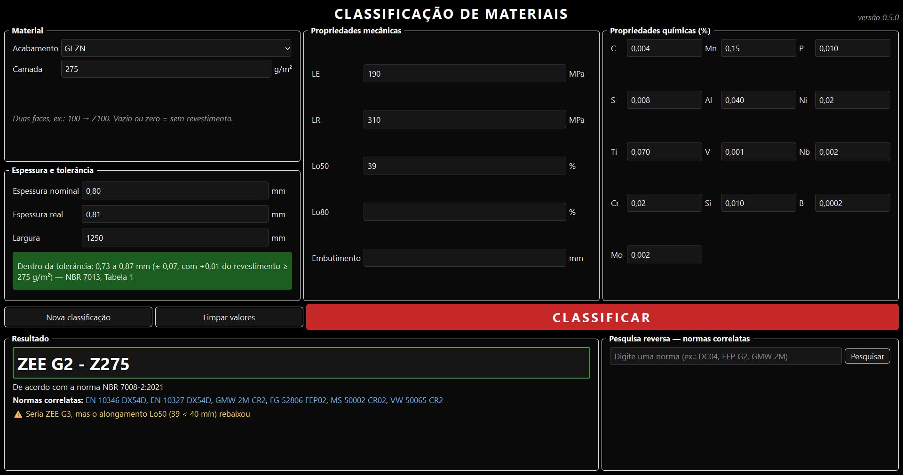
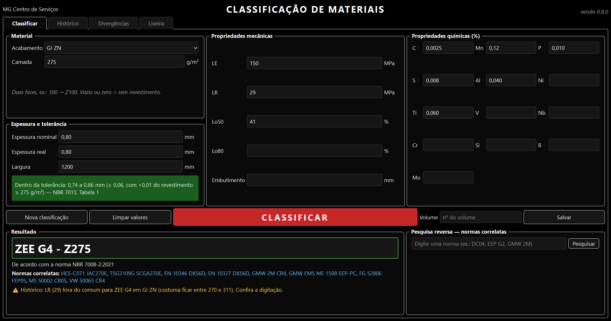
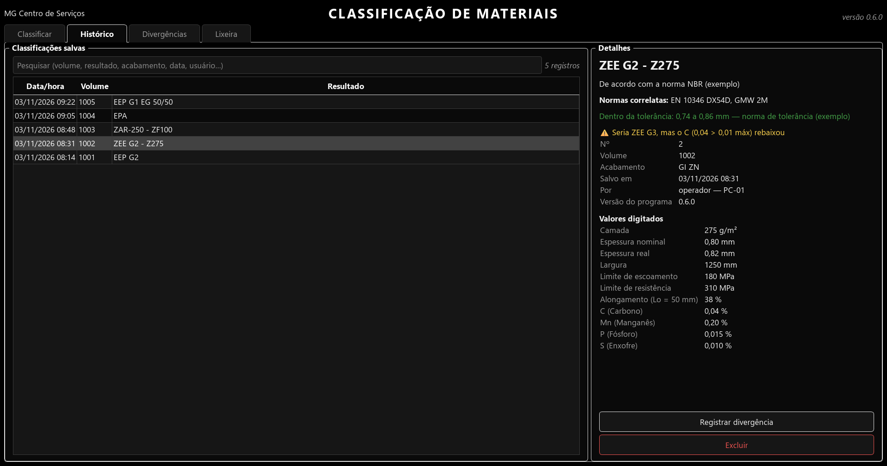
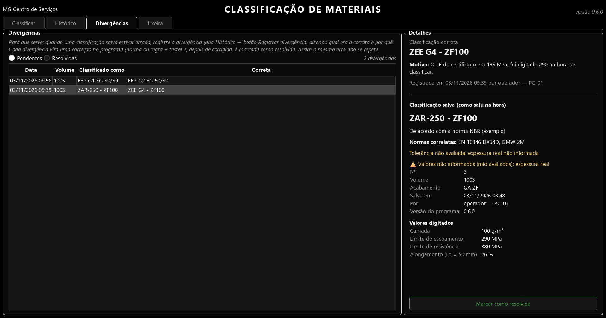
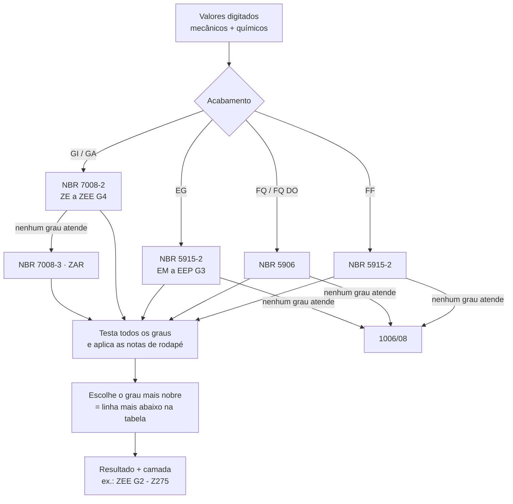
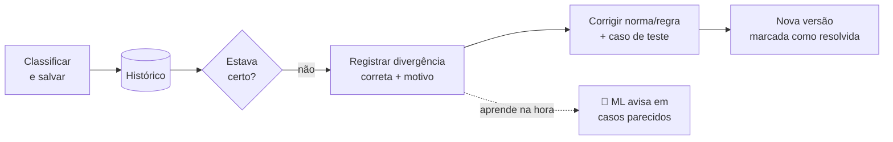
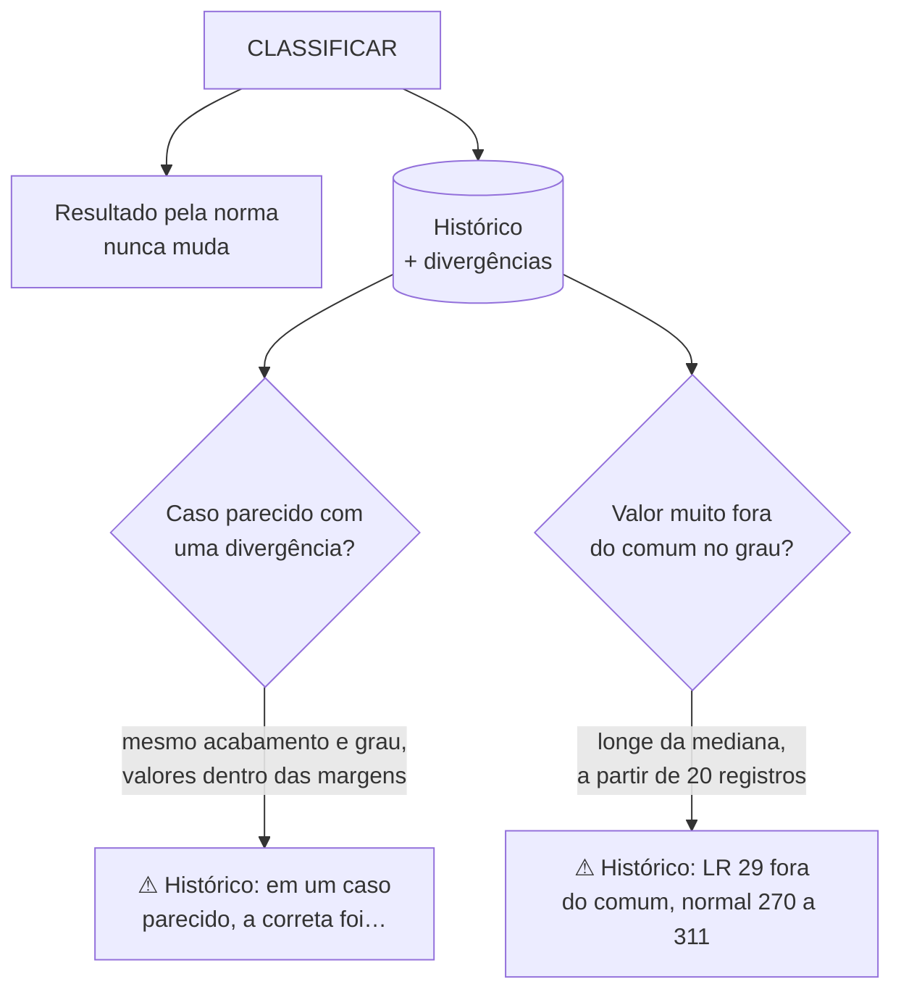
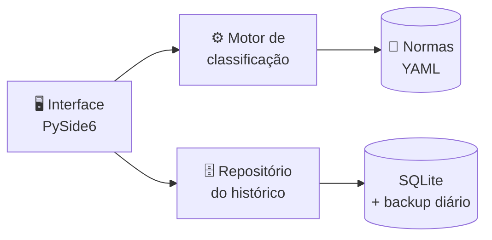
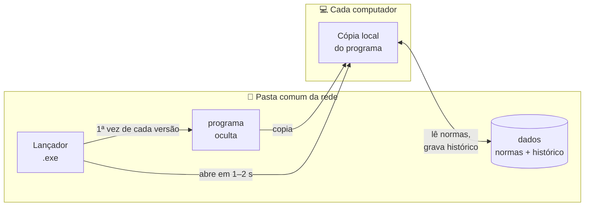
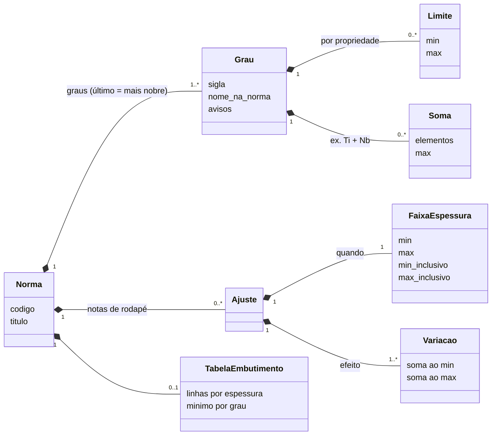

# Sistema de Classificação Automática de Aços Planos

<p align="center">
  
  
  
  
  
  
  
</p>
<p align="center">
  
  
  
  
  
  
  
</p>
<p align="center">
  
  
  
  
</p>

<p align="center">
  Aplicação desktop da <b>MG Centro de Serviços</b> que classifica aços planos — laminados a frio, a quente e
  zincados — a partir das propriedades mecânicas e químicas, indicando o grau conforme as normas ABNT.
</p>

<p align="center">
  <a href="#-visão-geral">Visão Geral</a> •
  <a href="#-funcionalidades">Funcionalidades</a> •
  <a href="#-como-a-classificação-funciona">Como funciona</a> •
  <a href="#️-arquitetura">Arquitetura</a> •
  <a href="#-roteiro">Roteiro</a>
</p>

---

## 📌 Visão Geral

Classificar uma bobina de aço significa comparar dezenas de valores — limite de escoamento, resistência,
alongamento, carbono, manganês, alumínio… — com as tabelas de várias normas, aplicando notas de rodapé
que mudam os limites conforme a espessura e o revestimento. Feito à mão, o processo é lento e sujeito a erro.

Este sistema automatiza essa comparação: o usuário digita os valores do certificado e recebe a
classificação no formato usado no dia a dia, por exemplo:

| Acabamento | Exemplo de resultado |
|---|---|
| Laminado a frio (FF) | `EEP G2` |
| Zincado por imersão (GI) | `ZEE G2 - Z275` |
| Zinco-ferro (GA) | `ZE - ZF100` |
| Eletrolítico (EG) | `EEP G3 EG 50/50` |

<details open>
<summary><b>🖥️ Tela principal</b></summary>

<p align="center">
  
</p>

<sub>Valores fictícios. Vermelho só no botão principal e em erros, amarelo em avisos e verde no que
está certo (tolerância dentro e contorno do resultado).</sub>

</details>

<details>
<summary><b>🤖 Machine learning — erro que a norma não pega</b></summary>

<p align="center">
  
</p>

<sub>Histórico e valores fictícios. Digitaram LR 29 em vez de 290: a norma só limita o máximo do LR
e aceita (ZEE G4), mas o ML compara com as classificações salvas do mesmo grau e avisa.</sub>

</details>

<details>
<summary><b>🗂️ Histórico</b></summary>

<p align="center">
  
</p>

<sub>Dados fictícios. Lista (data/hora, volume, resultado) e, ao lado, o registro completo como saiu
na hora — com avisos, tolerância e valores digitados.</sub>

</details>

<details>
<summary><b>🔁 Divergências</b></summary>

<p align="center">
  
</p>

<sub>Dados fictícios. Cada divergência mostra a classificação correta, o motivo e o registro
original, até ser marcada como resolvida.</sub>

</details>

## ✨ Funcionalidades

- 🔎 **Classificação automática** — sempre no **grau mais nobre** atendido.
- ⚠️ **Avisos inteligentes** — valores não informados e "quase passou"
  (*"Seria EEP G3, mas o alongamento rebaixou"*).
- 📏 **Tolerância de espessura** — dentro/fora (verde/vermelho), com o intervalo e a norma usada.
- 🔗 **Normas correlatas** — equivalências de montadoras (Honda, Toyota, GM, VW, Stellantis…) com
  identificação do fabricante ao passar o mouse.
- ↩️ **Pesquisa reversa** — digite qualquer norma e veja os intervalos exigidos.
- 🗂️ **Histórico** — cada classificação salva com o volume, quem salvou, em qual PC e com qual
  versão do programa; pesquisa por texto livre em tudo o que foi salvo.
- 🗑️ **Lixeira** — excluir não apaga: o registro pode ser restaurado ou excluído de vez, sempre com
  confirmação.
- 🔁 **Melhoria contínua** — quando uma classificação salva estava errada, registra-se a
  **divergência** (classificação correta + motivo); cada uma vira correção de regra e caso de teste.
- 🛡️ **Uso em rede sem servidor** — banco SQLite numa pasta comum, com backup diário automático;
  duas pessoas podem classificar e salvar ao mesmo tempo.
- 🚀 **Executável para Windows** — não precisa instalar nada; mora na pasta da rede, mas abre em
  1–2 segundos porque cada PC guarda uma cópia local do programa.
- 🤖 **Machine learning** — aprende com o histórico e com as divergências e **avisa** quando um
  valor está fora do comum para o grau (ex.: erro de digitação que a norma aceita) ou quando o
  material é parecido com um caso que já teve divergência. Aprende na hora, sem mudar código; só
  alerta — a classificação continua sempre pela regra da norma.

<details>
<summary><b>📚 Normas cobertas</b> (clique para expandir)</summary>

| Norma | Produto | Graus |
|---|---|---|
| NBR 5915-2 | Laminado a frio — estampagem | EM, EP, EEP G1–G4 |
| NBR 5906 | Laminado a quente | EM, EP, EPA |
| NBR 7008-2 | Zincado por imersão — estampagem | ZE, ZEE G1–G4 (ZC na norma, nunca é resultado) |
| NBR 7008-3 | Zincado por imersão — estrutural | ZAR |
| NBR 11888 | Tolerâncias — sem revestimento | — |
| NBR 7013 | Tolerâncias — zincados | — |

</details>

## 🧠 Como a classificação funciona



<details>
<summary><b>⚠️ Avisos que acompanham o resultado</b></summary>

```text
RESULTADO: ZEE G2 - Z275
De acordo com a norma NBR 7008-2:2021
Normas correlatas: EN 10346 DX54D, EN 10327 DX54D, GMW 2M CR2, FG 52806 FEP02, MS 50002 CR02, …
🟢 Dentro da tolerância: 0,74 a 0,86 mm (± 0,06, com +0,01 do revestimento ≥ 275 g/m²) — NBR 7013, Tabela 1
⚠ Seria ZEE G3, mas o C (0,04 > 0,01 máx) rebaixou
⚠ Valores não informados (não avaliados): alongamento Lo80
⚠ Limites ajustados pela espessura: Tabela 2, nota d
```

| Aviso | Quando aparece |
|---|---|
| **Quase passou** | Um grau mais nobre falhou por uma única variável |
| **Valores não informados** | Campo exigido ficou vazio (vale zero, ou não é avaliado no caso de embutimento/alongamento) |
| **Grau inexistente no acabamento** | Ex.: atende EEP G4, mas não existe EEP G4 EG → sai EEP G3 EG |
| **Limites ajustados** | Uma nota de rodapé mudou os limites (espessura ou zinco-ferro) |
| **Aviso do grau** | Observação da norma, ex.: EEP G4 não substitui EEP G3 sem autorização |

As **normas correlatas** (folha de classificações + planilha de equivalência) aparecem numa
lista simples junto do resultado.

A **pesquisa reversa** faz o caminho inverso: digitada qualquer norma — NBR ou correlata, como
`DC04` ou `GMW 2M CR3` — e, se quiser, a espessura, mostra o que cada campo da tela precisa ter,
usando os mesmos limites do classificador.

</details>

## 🔁 Melhoria contínua

Uma classificação errada nunca passa em silêncio: ela vira dado organizado para corrigir o programa
— e, no futuro, para o machine learning avisar em casos parecidos.



<details>
<summary><b>🤖 Como o machine learning decide avisar</b></summary>



| Aviso | Como funciona |
|---|---|
| **Caso parecido** | Busca de vizinhos mais próximos (`NearestNeighbors`, scikit-learn) entre os casos que tiveram divergência: mesmo acabamento, mesmo grau e cada valor dentro da sua margem (ex.: LE ± 20 MPa, químicos ± 25 %). Mostra o mais próximo, com a classificação correta e o motivo. |
| **Fora do comum** | Estatística robusta por acabamento e grau: mediana e faixa central de cada valor, que não se deixam enganar por um erro antigo salvo. Só avisa o que está muito fora, para não virar ruído. |

Numa demonstração com histórico fictício de 340 classificações, o aviso de "fora do comum" não
deu **nenhum alarme falso** nas classificações normais.

</details>

## 🏛️ Arquitetura

Camadas independentes: a interface **não contém regras** e o motor **não conhece a interface** — por isso
o motor é testado automaticamente, sem abrir nenhuma janela.



<details>
<summary><b>🚀 Distribuição na rede (sem servidor)</b></summary>

Na pasta da rede aparece um único arquivo: o **lançador**. Ele copia o programa para o PC uma vez
por versão e abre a cópia local; normas e histórico continuam na rede, iguais para todos.



- **Atualizar** = trocar a pasta do programa; cada PC copia a versão nova sozinho.
- **Norma corrigida** = trocar o arquivo YAML, sem gerar o programa de novo.
- Cópia segura: uma cópia interrompida nunca é usada e duas aberturas ao mesmo tempo não se
  atrapalham.

</details>

<details>
<summary><b>🧩 Modelo de dados de uma norma</b></summary>

Cada norma é um arquivo YAML validado ao carregar — exemplo completo em
[`tests/dados/norma-ficticia.yaml`](tests/dados/norma-ficticia.yaml).



Erros de transcrição (campo com nome errado, chave repetida, `min > max`, grau inexistente…) são
apontados com **arquivo, linha e campo**:

```text
nbr-exemplo.yaml, linha 8 (graus → 1 → limites → LE): mínimo (280) maior que o máximo (140)
```

</details>

| Tecnologia | Aplicação no projeto |
|---|---|
| Python | Motor de regras, validação e lógica da aplicação. |
| PySide6 (Qt) | Interface desktop em tela cheia, com abas e tooltips. |
| SQLite | Histórico, lixeira e divergências numa pasta de rede (journal tradicional, backup diário). |
| scikit-learn + NumPy | Machine learning: casos parecidos com divergências e valores fora do comum. |
| YAML + Pydantic | Base de normas legível e validada ao carregar. |
| Pytest + Ruff | Testes automáticos e qualidade do código. |
| PyInstaller | Executável para Windows, com lançador que copia o programa para o PC e abre rápido. |
| Git + GitHub | Controle de versão e documentação. |
| Claude Code | Desenvolvimento assistido por IA, guiado por `CLAUDE.md` e ADRs. |

<details>
<summary><b>📝 Decisões de arquitetura (ADRs)</b></summary>

| ADR | Decisão |
|---|---|
| [0001](docs/decisoes/0001-python-pyside6.md) | Python + PySide6 para o programa desktop |
| [0002](docs/decisoes/0002-sqlite-historico.md) | SQLite para o histórico (com lixeira) |
| [0003](docs/decisoes/0003-repositorio-publico-dados-fora-do-git.md) | Repositório público com dados das normas fora do Git |
| [0004](docs/decisoes/0004-normas-em-yaml.md) | Base de normas em arquivos YAML |
| [0005](docs/decisoes/0005-formato-yaml-normas.md) | Formato detalhado do YAML e regras de interpretação |
| [0006](docs/decisoes/0006-motor-de-classificacao.md) | Motor de classificação: etapas e regras |
| [0007](docs/decisoes/0007-notas-por-motivo-e-correlatas.md) | Notas por motivo/acabamento e normas correlatas |
| [0008](docs/decisoes/0008-tolerancia-de-espessura.md) | Tolerância de espessura (NBR 11888 e NBR 7013) |
| [0009](docs/decisoes/0009-interface-e-resultado-sem-grau.md) | Interface (layout em faixas, cores, versão) e resultado sem grau (ZC de último recurso) |
| [0010](docs/decisoes/0010-historico-lixeira-e-divergencias.md) | Histórico, lixeira e divergências (SQLite em rede, abas, melhoria contínua) |
| [0011](docs/decisoes/0011-executavel-e-entrega-na-rede.md) | Executável e entrega na pasta da rede (lançador com cópia local) |
| [0012](docs/decisoes/0012-machine-learning-avisos-do-historico.md) | Machine learning: avisos aprendidos do histórico (nunca muda o resultado) |

</details>

## 📁 Estrutura do Repositório

```text
SistemaDeClassificacao/
├── src/classificador/
│   ├── dominio/         # propriedades, amostra, modelos (norma, grau, folha de classificações)
│   ├── normas/          # carregador do YAML e comando de conferência
│   ├── motor/           # limites, avaliação, classificação, sequência, saída, pesquisa reversa
│   ├── tolerancia/      # tolerância de espessura (real × nominal)
│   ├── historico/       # banco SQLite, repositório, lixeira, divergências e backup
│   ├── aprendizado/     # machine learning: casos parecidos e valores fora do comum
│   ├── interface/       # janela PySide6 em abas (só mostra; as regras ficam no motor)
│   └── lancador.py      # lançador da rede: copia o programa para o PC e abre rápido
├── tests/               # testes automáticos
│   └── dados/           # norma, folha, correlatas e tolerância fictícias usadas nos testes
├── docs/decisoes/       # registros de decisões de arquitetura (ADRs)
├── docs/imagens/        # fotos da tela (dados fictícios)
├── dados/               # NÃO versionado
│   ├── normas/          # normas transcritas (YAML)
│   ├── tolerancias/     # NBR 11888 e NBR 7013 transcritas (YAML)
│   ├── casos/           # certificados reais com a classificação esperada
│   ├── testes/          # testes com valores das normas reais
│   ├── folha-classificacoes.yaml
│   └── correlatas.yaml
├── pyproject.toml       # dependências e configuração das ferramentas
├── CLAUDE.md            # instruções do projeto para o Claude Code
└── README.md
```

## 🗺️ Roteiro

- [x] **Fase 0** — Fundação: repositório, ADRs, ambiente Python, permissões do Claude Code
- [x] **Fase 1** — Modelo de dados, formato YAML validado e NBR 5915-2 transcrita e conferida
- [x] **Fase 2** — Motor de classificação (com testes primeiro): sequência por acabamento,
  "quase passou", valores faltando, saída formatada e pesquisa reversa
- [x] **Fase 3** — NBR 5906, 7008-2 e 7008-3 transcritas e conferidas; normas correlatas e pesquisa
  reversa por qualquer norma
- [x] **Fase 4** — Tolerância de espessura: NBR 11888 (Tab. 11) e NBR 7013 (Tab. 1–4) transcritas e
  conferidas; dentro/fora com intervalo e norma
- [x] **Fase 5** — Interface PySide6: tela em faixas simétricas, tema escuro com cores de significado
  fixo, classificação, tolerância, correlatas e pesquisa reversa na tela
- [x] **Fase 6** — Histórico em SQLite na rede (backup diário), abas Histórico, Divergências e
  Lixeira, pesquisa por texto livre e registro de divergências (melhoria contínua)
- [x] **Fase 7** — Executável para Windows na pasta da rede: lançador com cópia local (abre em
  1–2 s), dados ao lado do programa e teste com dois PCs salvando ao mesmo tempo
- [x] **Fase 8** — Machine learning: avisos de valores fora do comum e de casos parecidos com
  divergências já registradas (aprende na hora, nunca muda o resultado)

## ⚖️ Direitos autorais

O conteúdo das normas ABNT é protegido e **não faz parte deste repositório**. As tabelas transcritas
ficam apenas na pasta local `dados/`, listada no `.gitignore`.

---

<p align="center">
  <b>Projeto de desenvolvimento de software aplicado à qualidade na indústria do aço, com foco em
  automação de processos, rastreabilidade e redução de erros de classificação.</b>
</p>
