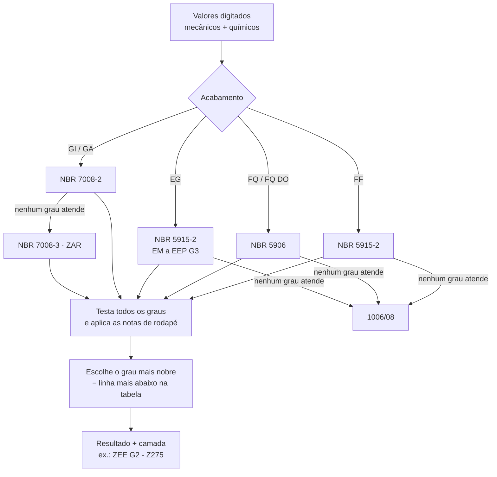
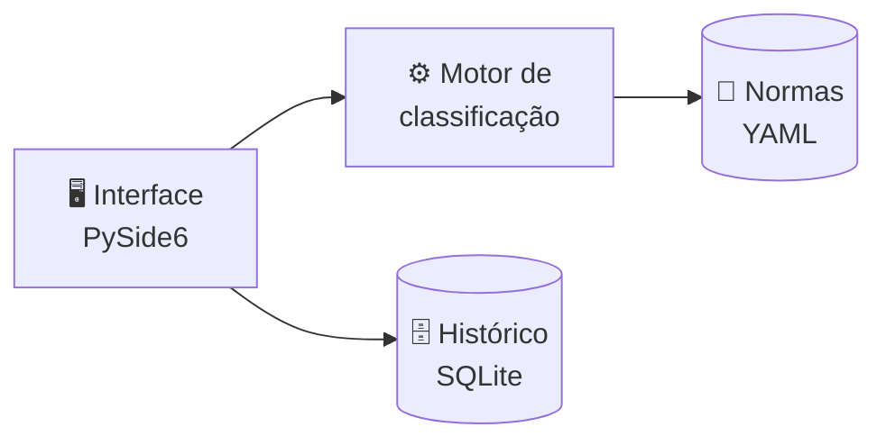

# Sistema de Classificação Automática de Aços Planos

<p align="center">
  
  
  
  
  
</p>
<p align="center">
  
  
  
  
  
  
  
</p>
<p align="center">
  
  
  
  
</p>

<p align="center">
  Aplicação desktop da <b>MG Centro de Serviço</b> que classifica aços planos — laminados a frio, a quente e
  zincados — a partir das propriedades mecânicas e químicas, indicando o grau conforme as normas ABNT.
</p>

<p align="center">
  <a href="#-visão-geral">Visão Geral</a> •
  <a href="#-funcionalidades">Funcionalidades</a> •
  <a href="#-como-a-classificação-funciona">Como funciona</a> •
  <a href="#️-arquitetura">Arquitetura</a> •
  <a href="#-como-executar">Como executar</a> •
  <a href="#-roteiro">Roteiro</a>
</p>

---

## 📌 Visão Geral

Classificar uma bobina de aço significa comparar dezenas de valores — limite de escoamento, resistência,
alongamento, carbono, manganês, alumínio… — com as tabelas de várias normas, aplicando notas de rodapé
que mudam os limites conforme a espessura e o revestimento. Feito à mão, o processo é lento e sujeito a erro.

Este sistema automatiza essa comparação: o usuário digita os valores do certificado e recebe a
classificação no formato usado no dia a dia, por exemplo:

| Acabamento | Exemplo de resultado |
|---|---|
| Laminado a frio (FF) | `EEP G2` |
| Zincado por imersão (GI) | `ZEE G2 - Z275` |
| Zinco-ferro (GA) | `ZE - ZF100` |
| Eletrolítico (EG) | `EEP G3 EG 50/50` |

## ✨ Funcionalidades

- 🔎 **Classificação automática** — sempre no **grau mais nobre** atendido.
- ⚠️ **Avisos inteligentes** — valores não informados e "quase passou"
  (*"Seria EEP G3, mas o alongamento rebaixou"*).
- 📏 **Tolerância de espessura** — dentro/fora (verde/vermelho), com o intervalo e a norma usada.
- 🔗 **Normas correlatas** — equivalências de montadoras (Honda, Toyota, GM, VW, Stellantis…) com
  identificação do fabricante ao passar o mouse.
- ↩️ **Pesquisa reversa** — digite qualquer norma e veja os intervalos exigidos.
- 🗂️ **Histórico** — classificações salvas e pesquisáveis, com **lixeira** (restaurar ou excluir de vez).
- 🤖 **Detecção de outliers** *(planejado)* — machine learning sobre o histórico para apontar valores fora do comum.

<details>
<summary><b>📚 Normas cobertas</b> (clique para expandir)</summary>

| Norma | Produto | Graus |
|---|---|---|
| NBR 5915-2 | Laminado a frio — estampagem | EM, EP, EEP G1–G4 |
| NBR 5906 | Laminado a quente | EM, EP, EPA |
| NBR 7008-2 | Zincado por imersão — estampagem | ZC, ZE, ZEE G1–G4 |
| NBR 7008-3 | Zincado por imersão — estrutural | ZAR |
| NBR 11888 | Tolerâncias — sem revestimento | — |
| NBR 7013 | Tolerâncias — zincados | — |

</details>

## 🧠 Como a classificação funciona



## 🏛️ Arquitetura

Camadas independentes: a interface **não contém regras** e o motor **não conhece a interface** — por isso
o motor é testado automaticamente, sem abrir nenhuma janela.



| Tecnologia | Aplicação no projeto |
|---|---|
| Python | Motor de regras, validação e lógica da aplicação. |
| PySide6 (Qt) | Interface desktop em tela cheia, com abas e tooltips. |
| SQLite | Histórico de classificações e lixeira. |
| YAML + Pydantic | Base de normas legível e validada ao carregar. |
| Pytest + Ruff | Testes automáticos e qualidade do código. |
| PyInstaller | Geração do executável `.exe` para Windows. |
| Git + GitHub | Controle de versão e documentação. |
| Claude Code | Desenvolvimento assistido por IA, guiado por `CLAUDE.md` e ADRs. |

<details>
<summary><b>📝 Decisões de arquitetura (ADRs)</b></summary>

| ADR | Decisão |
|---|---|
| [0001](docs/decisoes/0001-python-pyside6.md) | Python + PySide6 para o programa desktop |
| [0002](docs/decisoes/0002-sqlite-historico.md) | SQLite para o histórico (com lixeira) |
| [0003](docs/decisoes/0003-repositorio-publico-dados-fora-do-git.md) | Repositório público com dados das normas fora do Git |
| [0004](docs/decisoes/0004-normas-em-yaml.md) | Base de normas em arquivos YAML |

</details>

## 📁 Estrutura do Repositório

```text
SistemaDeClassificacao/
├── src/classificador/   # código: domínio, normas, motor, tolerância, histórico, interface
├── tests/               # testes automáticos (usam uma norma fictícia)
├── docs/decisoes/       # registros de decisões de arquitetura (ADRs)
├── dados/               # normas transcritas e casos reais — NÃO versionado
├── pyproject.toml       # dependências e configuração das ferramentas
├── CLAUDE.md            # instruções do projeto para o Claude Code
└── README.md
```

## 🚀 Como executar

Requisitos: **Windows** e **Python 3.12+**. No PowerShell, na pasta do projeto:

```powershell
python -m venv .venv
.\.venv\Scripts\python.exe -m pip install -e ".[dev]"
.\.venv\Scripts\python.exe -m pytest
```

> A interface ainda não está disponível — por enquanto o projeto contém a base e os testes.

## 🗺️ Roteiro

- [x] **Fase 0** — Fundação: repositório, ADRs, ambiente Python, permissões do Claude Code
- [ ] **Fase 1** — Modelo de dados e formato YAML das normas
- [ ] **Fase 2** — Motor de classificação (com testes primeiro)
- [ ] **Fase 3** — Transcrição das demais normas
- [ ] **Fase 4** — Tolerância de espessura
- [ ] **Fase 5** — Interface PySide6
- [ ] **Fase 6** — Histórico, lixeira e pesquisa
- [ ] **Fase 7** — Executável `.exe`
- [ ] **Fase 8** — Detecção de outliers com machine learning

## ⚖️ Direitos autorais

O conteúdo das normas ABNT é protegido e **não faz parte deste repositório**. As tabelas transcritas
ficam apenas na pasta local `dados/`, listada no `.gitignore`.

---

<p align="center">
  <b>Projeto de desenvolvimento de software aplicado à qualidade na indústria do aço, com foco em
  automação de processos, rastreabilidade e redução de erros de classificação.</b>
</p>
