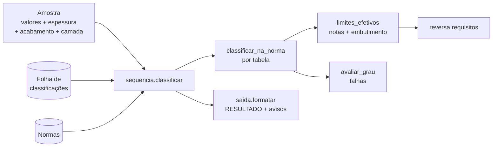

# 0006 — Motor de classificação: etapas e regras

- **Status:** aceita
- **Data:** 2026-10-27
- **Complementa:** [0004](0004-normas-em-yaml.md), [0005](0005-formato-yaml-normas.md)

## Contexto
Com as normas em YAML validado (Fase 1), faltava a lógica que compara os valores digitados com
as normas e devolve a classificação no formato usado na empresa. As regras de comportamento
(vazios, "quase passou", recorte por acabamento, formato da camada) foram decididas com o usuário.

## Decisão — etapas do motor (`src/classificador/motor/`)

| Etapa | Responsabilidade |
|---|---|
| `limites_efetivos` | Limites do grau na espessura nominal: notas de rodapé (maior variação, sem acumular) e linha do embutimento (mais próxima; empate → maior; fora da tabela → não avaliado). Compartilhada com a pesquisa reversa. |
| `avaliar_grau` | Compara de forma **exata** (sem arredondar) e lista cada falha com valor e limite. |
| `classificar_na_norma` | Grau mais nobre atendido, recortado pelos graus **disponíveis** do acabamento; "quase passou"; valores faltando. |
| `classificar` (sequência) | Percorre as tabelas do acabamento conforme a folha de classificações e aplica o `se_nenhum`. |
| `formatar` | RESULTADO com camada, linha "De acordo com a norma", avisos em ordem fixa. |
| `requisitos` | Pesquisa reversa por norma + grau, com espessura opcional. |

A **folha de classificações** (quais tabelas e graus valem para cada acabamento) é um YAML em
`dados/`, validado como as normas — exemplo versionado em `tests/dados/folha-ficticia.yaml`.

## Decisão — regras (decididas com o usuário)
- **Recorte por acabamento:** se o melhor grau atendido não pode ser resultado no acabamento,
  desce para o mais nobre disponível abaixo dele (EG: EEP G4 → EEP G3, com aviso); se não há
  nenhum abaixo, a tabela não dá resultado e passa para a próxima (ZC nunca é resultado → 7008-3).
- **Nobreza GI/GA:** todos os ZAR (7008-3) são mais nobres que os graus da 7008-2.
- **"Quase passou":** só o grau **mais nobre**, entre os disponíveis acima do resultado e **na tabela
  do resultado**, que falhou por **uma única variável**; Lo50 e Lo80 contam separado; vale também
  quando nenhum grau atende (`1006/08`).
- **Vazios:** valem zero, exceto embutimento e o alongamento não preenchido quando o outro foi
  (não avaliados). Aviso de "não informado" só para campos exigidos pelo grau do resultado ou que,
  valendo zero, barraram um grau mais nobre.
- **Camada:** sai como digitada (`Z100`, `ZF100`, EG `50/50` a partir de um número por face); vazio
  ou zero = sem revestimento; FF/FQ ignoram a camada.

## Testes
- Versionados: normas e folha fictícias cobrem cada regra (inclusive a queda para a 2ª tabela).
- Locais (`dados/testes/`): NBR 5915-2 e folha reais; casos reais em `dados/casos/*.yaml` com o
  RESULTADO esperado — pulados enquanto a norma do caso não estiver transcrita.

## Consequências
- ✅ A interface (Fase 5) só exibe textos prontos; nenhuma regra fica na tela.
- ✅ Classificador e pesquisa reversa usam os mesmos limites e nunca discordam.
- ✅ Novas normas (Fase 3) entram só com YAML; o motor não muda.
- ⚠️ Normas correlatas ficam vazias até a planilha de equivalência ser transcrita (Fase 3).
